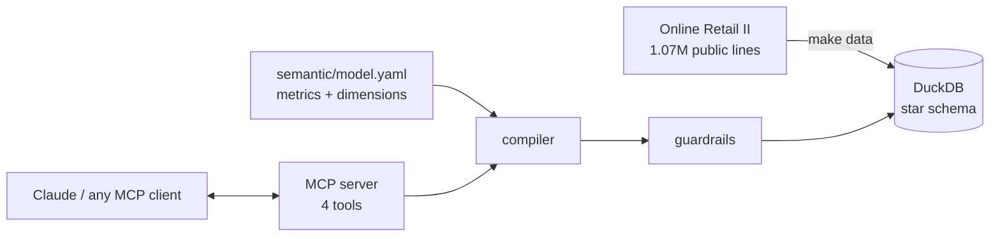

# zigmo

**Your business data, explained by an ape.** zigmo is a semantic-layer engine for business
metrics, exposed as an [MCP](https://modelcontextprotocol.io) server. Ask in plain words —
"which countries drive our revenue?" — and an AI agent answers with governed numbers, the
share of the total, and the exact SQL behind them. No dashboard required.

*zig* is the zigzag every metric draws over time (and a nod to sigma); *mo* is the
monkey. Pronounced *zig-mo*. Part of the [nxape](https://github.com/nxape) family.

[](https://github.com/unprimathe/zigmo/actions/workflows/ci.yml)



## Why

Dashboards answer the questions someone predicted. Letting an LLM write SQL answers any
question, but each answer may define "revenue" differently, cost an unbounded scan, or
open an injection hole. zigmo sits in between:

- **One meaning per metric.** `gross_revenue`, `return_rate` and friends are defined once in
  [`semantic/model.yaml`](semantic/model.yaml). Every answer uses the same definition.
- **Agents ask for names, not SQL.** The compiler turns metrics, dimensions and filters into
  one parameterized query, joining only the tables it needs.
- **Guardrails by default.** Read-only connection, allowlists, a cost pre-flight, a timeout
  and an audit log of every call.
- **Evals that prove it.** 15 business questions checked against hand-written oracle
  queries in CI, plus an optional eval where Claude answers them through the MCP tools.

## Quickstart

Requires [uv](https://docs.astral.sh/uv/).

```bash
git clone https://github.com/unprimathe/zigmo && cd zigmo
make setup     # install
make data      # download the dataset (45 MB) and build data/zigmo.duckdb (~2 s)
make test      # 30 unit and guardrail tests
make evals     # 15 business questions vs. oracle queries
```

Connect it to **Claude Code**:

```bash
claude mcp add zigmo -- uv --directory "$PWD" run zigmo-server
```

or to **Claude Desktop** (`claude_desktop_config.json`):

```json
{ "mcpServers": { "zigmo": { "command": "uv",
  "args": ["--directory", "/absolute/path/to/zigmo", "run", "zigmo-server"] } } }
```

Then ask: *"What share of gross revenue do our top 3 countries have?"*

## Tools

| Tool | What it does |
|---|---|
| `list_metrics` | The catalog: every metric and dimension with its business meaning |
| `describe_metric` | How one metric is defined (formula, filter, format) |
| `query_metrics` | Metrics split by up to 3 dimensions, with filters, date range, sorting and optional share of total |
| `explain_query` | The optimized SQL and DuckDB plan for a request, without running it — paste it into any BI tool |

All four are annotated read-only.

### Example

`query_metrics(metrics=["gross_revenue"], dimensions=["country"], limit=3, with_share=true)`

| country | gross_revenue (GBP) | share |
|---|---:|---:|
| United Kingdom | 16,801,004.62 | 85.5% |
| EIRE | 623,414.16 | 3.2% |
| Netherlands | 549,773.41 | 2.8% |

The response also carries the SQL that produced it:

```sql
SELECT co.country AS country,
       SUM(f.amount) FILTER (WHERE NOT f.is_return) AS gross_revenue,
       CAST((SUM(f.amount) FILTER (WHERE NOT f.is_return)) AS DOUBLE)
         / NULLIF(SUM(SUM(f.amount) FILTER (WHERE NOT f.is_return)) OVER (), 0) AS gross_revenue_share
FROM fact_sales f
JOIN dim_country co ON co.country_key = f.country_key
GROUP BY ALL
ORDER BY gross_revenue DESC NULLS LAST
LIMIT 3
```

## The semantic model

| Metrics | Dimensions |
|---|---|
| `gross_revenue`, `returns_value`, `net_revenue`, `orders`, `units`, `customers`, `aov` (derived), `return_rate` (derived) | `country`, `product`, `stock_code`, `customer_id`, `year`, `quarter`, `month`, `week`, `day`, `day_of_week` |

Star schema: `fact_sales` (one row per invoice line, 1,021,252 rows) with `dim_date`,
`dim_product`, `dim_customer` and `dim_country`. How returns, guest checkouts and
non-merchandise lines are handled is in [ADR 3](docs/adr/0003-returns-guests-and-non-merchandise.md).

## Why these guardrails

| Guardrail | Stops |
|---|---|
| Allowlist (names must exist in the model) | Questions answered with made-up definitions; SQL fragments smuggled in as names |
| Bound parameters for every filter value | SQL injection: `country = "x' OR 1=1 --"` matches nothing |
| Limits (≤8 metrics, ≤3 dimensions, ≤1000 rows) | Runaway result sets in an agent loop |
| Read-only connection | Any write, even if every other layer failed |
| Pre-flight: `EXPLAIN` + group budget | Queries like *revenue by customer × product × day* (≈20 billion possible groups), rejected with advice to use coarser dimensions |
| Timeout | Long scans holding the database |
| Audit log (JSONL) | Unanswerable "what did the agent ask?" — every call, its SQL, rows and rejections |

Each one has a test in [`tests/`](tests/). Details in [ADR 4](docs/adr/0004-guardrails.md).

## Evals

- `make evals` — deterministic, runs in CI. Each question in
  [`evals/questions.yaml`](evals/questions.yaml) has a semantic request and an independent,
  hand-written oracle query; the results must match. Breaking a metric definition on
  purpose turns the run red (7/15), which is how we know the eval protects something.
- `make evals-llm` — Claude answers each question using only the MCP tools; a question
  passes when its last query returns the oracle's rows. Needs Anthropic credentials and
  costs money, so it is not in CI.

## Layout

```text
semantic/model.yaml        the semantic model
src/zigmo/ingest.py        download + clean + star schema
src/zigmo/semantic_layer.py  model loading and validation
src/zigmo/compiler.py      request -> parameterized SQL
src/zigmo/engine.py        guardrails, execution, audit
src/zigmo/server.py        MCP server
tests/                     unit and guardrail tests on a hand-checkable fixture
evals/                     deterministic and LLM evals
docs/adr/                  architecture decisions
```

## Data

[Online Retail II](https://archive.ics.uci.edu/dataset/502/online+retail+ii) by Daqing Chen,
UCI Machine Learning Repository, [doi:10.24432/C5CG6D](https://doi.org/10.24432/C5CG6D),
licensed [CC BY 4.0](https://creativecommons.org/licenses/by/4.0/). The data is downloaded
at build time and not redistributed here.

## License

Code: MIT. Built by [Roland Sencial](https://www.linkedin.com/in/rolandsencial) at
[nxape](https://nxape.dev).
